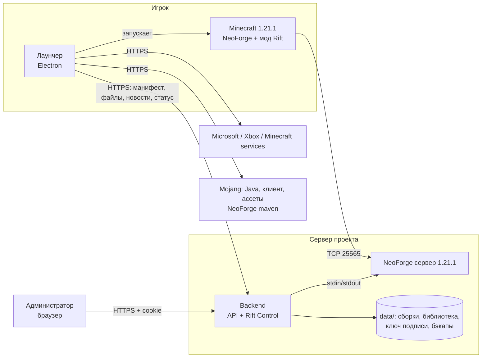

# Архитектура Spell and Iron Rift

## Принципы

- **Одна версия.** Minecraft 1.21.1, только NeoForge 21.1.x. Это проверяется на каждом уровне: схема манифеста (`shared/src/manifest.ts`), загрузка модов в админке (метаданные `neoforge.mods.toml`, диапазон версии Minecraft), установщик NeoForge в лаунчере и `server/install.sh`. Моды для Fabric, Quilt и старого Forge отклоняются при загрузке.
- **Одна сборка.** Опубликованная сборка — всегда одна (`stable`). Для проверки перед публикацией есть канал `testing`.
- **Только официальный сервер.** Мод убирает одиночную игру, создание мира, список серверов, прямое подключение и Realms. Кнопка «Войти в пространство» подключает к адресу из манифеста.

## Манифест сборки

Бэкенд собирает манифест из сборки и подписывает его ключом **Ed25519**. Лаунчер проверяет подпись встроенным публичным ключом (`launcher/config/app.json → trustedManifestKeys`). Секретный ключ лежит только на сервере, в `data/keys/`.

Каждый файл в манифесте содержит: путь, название, версию, размер, URL, SHA-256, категорию (`mod`/`config`/`resourcepack`/`shaderpack`/`other`), признак обязательности, сторону (`client`/`server`/`both`), режим (`replace` или `keep-user`) и необязательный список графических пресетов.

Ограничения путей (`isSafeManagedPath`): файлы пишутся только в `mods/`, `config/`, `defaultconfigs/`, `resourcepacks/`, `shaderpacks/`, `spellironrift/`. Пути с `..`, абсолютные пути и защищённые файлы игрока (`options.txt`, `servers.dat`, `screenshots/`, `saves/`, `logs/` и т. д.) отклоняются ещё при проверке манифеста.

## Обновление у игрока (`launcher/src/core/updater.ts`)

1. **План.** Сравнение манифеста с файлами на диске. Хеш берётся из кэша по размеру и времени изменения, иначе считается SHA-256. Скачиваются только новые и изменённые файлы.
2. **Загрузка** в хранилище по хешу (`.sir/objects/ab/abcd…`). Есть докачка по HTTP Range, проверка размера и SHA-256, повторы с паузой. В папке игры на этом этапе ничего не меняется.
3. **Журнал → применение.** Пишется `apply.journal.json`, затем каждый файл копируется во временный и атомарно переименовывается. Файлы, которые лаунчер ставил раньше и которых больше нет в сборке, удаляются. Чужие файлы (например, мод, добавленный игроком) не трогаются.
4. **Фиксация** состояния в `pack-state.json`, журнал удаляется. Если процесс прервали, при следующем запуске `recover()` доводит применение до конца.
5. **Откат** заново применяет предыдущий манифест из локального хранилища, без интернета. Блобы последних трёх сборок сохраняются.
6. **Восстановление файлов** пересчитывает хеши всех файлов сборки и заменяет повреждённые.

Конфиги с режимом `keep-user` ставятся, только если их ещё нет. Правки игрока не перезаписываются.

## Установка игры

- **Java 21** — официальные сборки рантайма Mojang (`java-runtime-delta`) с проверкой SHA-1 каждого файла. В настройках можно указать свою Java.
- **Minecraft 1.21.1** — манифест версий Mojang: клиент, библиотеки по правилам ОС, ассеты, конфиг логирования. Всё с проверкой SHA-1.
- **NeoForge** — официальный установщик с maven.neoforged.net. Перед запуском его контрольная сумма сверяется, затем он запускается в режиме `--install-client`. Неподходящую версию лаунчер не запустит.
- **Запуск** — объединение профилей (NeoForge `inheritsFrom` 1.21.1), правила аргументов, свои флаги JVM из настроек (опасные флаги вроде `-javaagent` и `-cp` отфильтровываются). Токен доступа скрывается в логах.

## Вход Microsoft (`launcher/src/core/auth.ts`)

Используется OAuth 2.0 Device Code: пользователь вводит код на странице Microsoft. Дальше цепочка Xbox Live → XSTS → `login_with_xbox` → проверка лицензии и профиля. Лаунчер **не видит пароль**. Хранится только refresh-токен Microsoft, зашифрованный средствами ОС (Electron `safeStorage`: DPAPI, Keychain, libsecret). Если шифрование недоступно, токен не сохраняется.

Смена скина идёт через официальный API `minecraftservices` (PNG 64×64, Classic или Slim).

Нужен собственный Azure App ID с доступом к Minecraft API (см. SETUP.md).

## Графические пресеты

Значения заданы в одном месте (`shared/src/presets.ts`) и продублированы в моде (`GraphicsPresets.java`).

| Пресет | Дальность | Симуляция | Частицы | Шейдеры |
|---|---|---|---|---|
| Минимальный | 8 | 6 | минимум | нет |
| Сбалансированный | 12 | 8 | уменьшенные | нет |
| Высокий | 16 | 10 | все | да (Iris + совместимый шейдерпак) |
| Ультра | 24 | 12 | все | да |

**Автоподбор** (`recommendPreset`) учитывает ОЗУ, число потоков CPU, производителя GPU, объём видеопамяти (nvidia-smi, реестр Windows, sysfs, system_profiler) и версию OpenGL. Шейдеры предлагаются, только если точно известно, что дискретная видеокарта и VRAM ≥ 3 ГБ. Шейдерпак ставится только для пресетов, указанных у файла в сборке. Совместимость с NeoForge 1.21.1 проверяется при загрузке в библиотеку. В `options.txt` записываются только ключи пресета: управление и остальные настройки игрока не меняются.

## Админ-панель Rift Control (`backend/`)

| Роль | Права |
|---|---|
| Владелец | всё, включая восстановление мира из бэкапа и управление сотрудниками |
| Администратор | запуск/стоп/рестарт, консоль, моды и ресурспаки, сборки и публикация, бэкапы, MOTD |
| Модератор | просмотр сервера, кик/бан/разбан, новости |

- **Вход:** пароли хранятся как scrypt-хеши. Сессия — HttpOnly cookie с SameSite=Strict (флаг Secure ставится при HTTPS). На все изменяющие запросы нужен CSRF-токен. Есть ограничение попыток входа по IP и логину. Пароль по умолчанию не создаётся: владелец заводится командой `create-owner`.
- **Библиотека:** загрузка потоком, вычисление SHA-256, хранение по хешу. Из jar-файлов читается `neoforge.mods.toml`: modId, версия, зависимости с диапазонами версий Maven, требуемые версии Minecraft и NeoForge. У ресурспаков проверяется `pack_format` (34 для 1.21.1).
- **Проверка сборки:** недостающие зависимости, неподходящие версии, несовместимые моды, дубли, зависимость не на той стороне (клиент/сервер), несовпадение с NeoForge. Сборку с ошибками нельзя отправить на тест или опубликовать.
- **Публикация:** проверка → бэкап мира (`pre-publish`) → остановка сервера (если выбран рестарт) → синхронизация серверных файлов (старые моды переносятся в `data/server-files-backup/<время>/`) → запуск → подписанный манифест. Откат публикует предыдущую сборку тем же путём.
- **Сервер:** процесс `run.sh` из NeoForge под надзором бэкенда. Консоль в реальном времени (SSE), команды через stdin, разбор вывода `list` и `neoforge tps`, CPU и память процесса.
- **Бэкапы:** на время копирования `save-off` и `save-all flush`, потом `tar.gz` мира и конфигов, ротация. Копии `pre-publish` и `pre-restore` не удаляются ротацией. Восстановление возможно только при остановленном сервере, и сначала сохраняется текущий мир.
- **Журнал действий** фиксирует каждое изменение: кто, что и когда.

## Локализация

- Лаунчер: `launcher/renderer/i18n.js`.
- Админка: `backend/public/admin/i18n.js`.
- Мод: `client-mod/src/main/resources/assets/spellironrift/lang/{ru_ru,uk_ua,en_us}.json`.
- Новости и правила хранятся в трёх языках. Если перевода нет, показывается русский текст.

Английский везде помечен как Beta.

## Безопасность — кратко

- В клиенте нет секретов: Azure client id и публичный ключ подписи открыты по своей природе.
- Обмен с бэкендом идёт только по HTTPS. HTTP допускается лишь для `localhost` при разработке, и только с явным флагом.
- Целостность сборки защищают подпись манифеста, SHA-256 каждого файла и белый список путей.
- Перед изменением сборки делается бэкап мира, старые серверные моды сохраняются.
- systemd-юнит запускает сервис от отдельного пользователя с `ProtectSystem=strict`.
